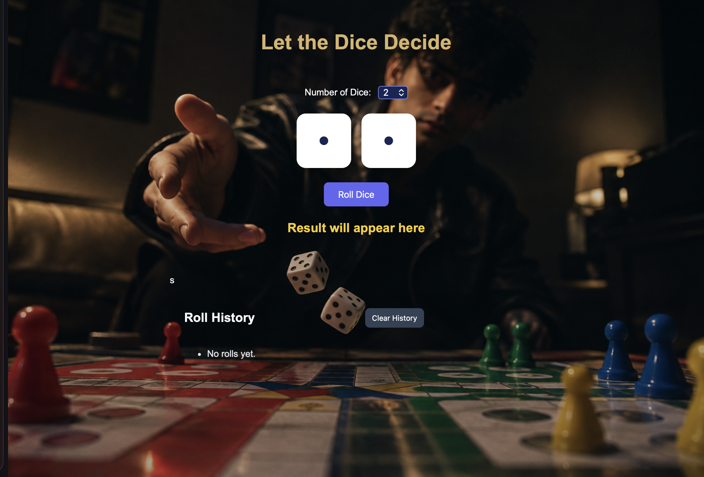

[🎲 Dice Roller

A simple and interactive Dice Roller web application built using HTML, CSS, and JavaScript.

📸 Project Screenshot

"Dice Roller Screenshot" 

📌 About the Project

Dice Roller is a beginner-friendly web development project that simulates rolling a dice. It provides a simple interface for users to roll the dice and view the result.

This project was created as part of my journey into web development and programming.

✨ Features

- 🎲 Interactive dice rolling
- 🔢 Random dice results
- 🎨 Styled user interface
- 🖼️ Background image asset
- ⚡ JavaScript-based interactivity

🛠️ Technologies Used

- HTML5 — Structures the web page.
- CSS3 — Styles the page and its layout.
- JavaScript — Handles the dice rolling logic.

📂 Project Structure

Dice-Roller/
├── index.html
├── style.css
├── script.js
├── background.png
├── screenshot.png
└── README.md

🚀 How to Run Locally

1. Clone this repository:
   
   git clone  
2. Open the downloaded project folder.

3. Open "index.html" in your web browser.

No additional dependencies are required for this basic HTML, CSS, and JavaScript project.

🌐 Live Demo

The live demo link will be added here once GitHub Pages is configured.

👨‍💻 Author

Abhinay Tiwari

Built as a learning project to explore web development using HTML, CSS, and JavaScript.

---

⭐ Thank you for checking out my Dice Roller project
